<p align="center">
  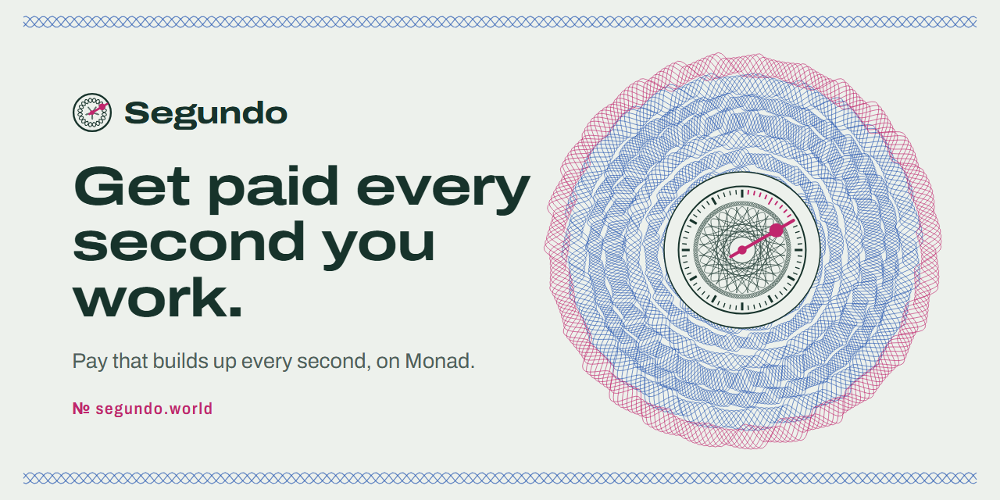
</p>

<p align="center">
  <a href="https://segundo.world"></a>
  
  
  
  <a href="https://github.com/RohanGlitched/segundo/actions/workflows/ci.yml"></a>
  
</p>

<h3 align="center">Cross-border freelancers get paid every second they work.<br/>In Agora's AUSD, on Monad, with a passkey and no gas.</h3>

<p align="center"><i>Segundo means "second" in Spanish, Portuguese and Filipino.</i></p>

| | |
|---|---|
| **App** | [segundo.world](https://segundo.world) (also [till-pay.vercel.app](https://till-pay.vercel.app)). Installs on a phone from the browser. |
| **Android app** | [segundo.world/segundo.apk](https://segundo.world/segundo.apk): a Trusted Web Activity, package `world.segundo.app` |
| **Passkey-only site** | [mera.segundo.world](https://mera.segundo.world): Mera passkeys are the whole account; no email, no practice wallet |
| **Business** | [segundo.world/business](https://segundo.world/business): live treasury, fees net of refunds, measured gas per action, break-even, market |
| **Monad, measured** | [segundo.world/network](https://segundo.world/network): 480 payouts in 4.67 s, 96 in one block |
| **Deck** | [segundo.world/deck](https://segundo.world/deck) |
| **One passkey, many keys** | [segundo.world/keys](https://segundo.world/keys) |
| **Privy in Segundo** | [segundo.world/privy](https://segundo.world/privy) |
| **Cash out** | [segundo.world/cashout](https://segundo.world/cashout): five corridors, simulated on testnet |
| **Request a tab** | [segundo.world/request](https://segundo.world/request): a freelancer's link that fills in the client's form |
| **Income statement** | [A demo freelancer's statement](https://segundo.world/proof/0x6dbb63ef35dF64E9423776bBf7a4c0a64565A160) (Ana Reyes, Manila), rebuilt from Monad through Envio HyperRPC |
| **Check it** | [VERIFY.md](VERIFY.md) (every action, the fee and its refunds on chain) · [SECURITY.md](SECURITY.md) · [cre/SIMULATION.md](cre/SIMULATION.md) |

---

<p align="center">
  
  <br/><sub>A real tab on Monad testnet, recorded from the live site. Lucas in São Paulo is paid by a studio in Singapore; each band of the rosette is a stretch of work, and the amount rolls in his own currency.</sub>
</p>

## Contents

[The problem](#the-problem) · [How it works](#how-it-works) · [Business model](#business-model) · [Bounties](#bounties) · [Monad integration](#monad-integration) · [Architecture](#architecture) · [Contracts](#contracts) · [Tests](#tests) · [Run it locally](#run-it-locally) · [Built with](#built-with)

## The problem

Freelancers outside the US and Europe wait for their money and pay to receive it.

| | |
|---|---|
| **6.36%** | average cost of sending money across borders ([World Bank, Remittance Prices Worldwide, Q3 2025](https://remittanceprices.worldbank.org/sites/default/files/2026-04/RPW_main_report_and_annex_Q325.pdf)) |
| **10 days** | before hourly marketplace pay is released after the work week ([Upwork Help Center](https://support.upwork.com/hc/en-us/articles/211063668-How-payments-for-hourly-contracts-work)) |
| **up to 435M** | online gig workers worldwide, 154M to 435M ([World Bank, 2023](https://openknowledge.worldbank.org/entities/publication/ebc4a7e2-85c6-467b-8713-e2d77e954c6c)) |

And if a client disappears, the freelancer chases an invoice for work already done.

## How it works

A client opens a **tab**: an hourly rate and a budget in **AUSD**, Agora's digital dollar. The budget waits in a contract on Monad that can only pay the freelancer for time on the clock or send it back to the client. While the freelancer is **clocked in**, pay builds up every second; while the tab is open on screen it lands in their wallet every few seconds. Either side can stop the clock at any moment, the client can pause pay or top up, and closing the tab returns every unspent cent in the same block.

Everyone signs in with a **passkey** (or email), nobody needs gas, and the app installs on a phone. Money moves on in three more ways: **send AUSD** by link, to an email address or to a wallet; **cash out** to a local corridor (simulated on testnet); and a freelancer can **request a tab** with one link.

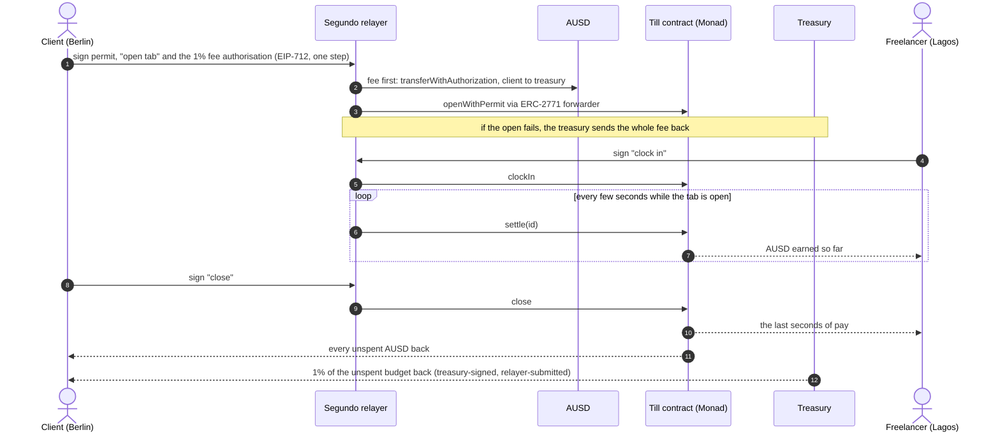

### Try it in one minute

1. Open **[segundo.world](https://segundo.world)** and choose **Open a tab**.
2. **Create your account with a passkey** (or continue with email, or use a practice wallet). No seed phrase, no gas.
3. 25 test AUSD arrive in your new wallet (there's also a **Get 25 test AUSD** button).
4. Pick a demo freelancer, say $40 an hour and a $3 budget. The form shows the 1% fee ($0.03) before you sign. Open the tab; the freelancer clocks in by themselves within seconds. Keep the page open and watch payouts land.
5. Close the tab: the unspent budget comes back, and so does 1% of it from the treasury. Then try **Send** (by link to your own phone), **Cash out**, or be the freelancer with **Someone I'll invite by link**.

<table>
  <tr>
    <td width="50%">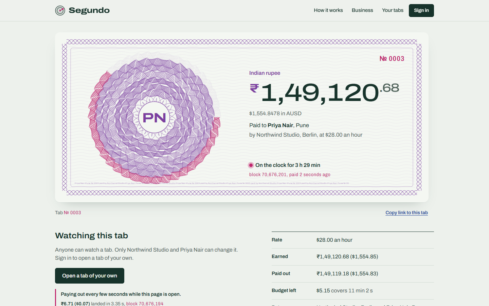<br/><sub><b>A live tab.</b> Payouts every few seconds while the page is open, each with how long it took to land.</sub></td>
    <td width="50%">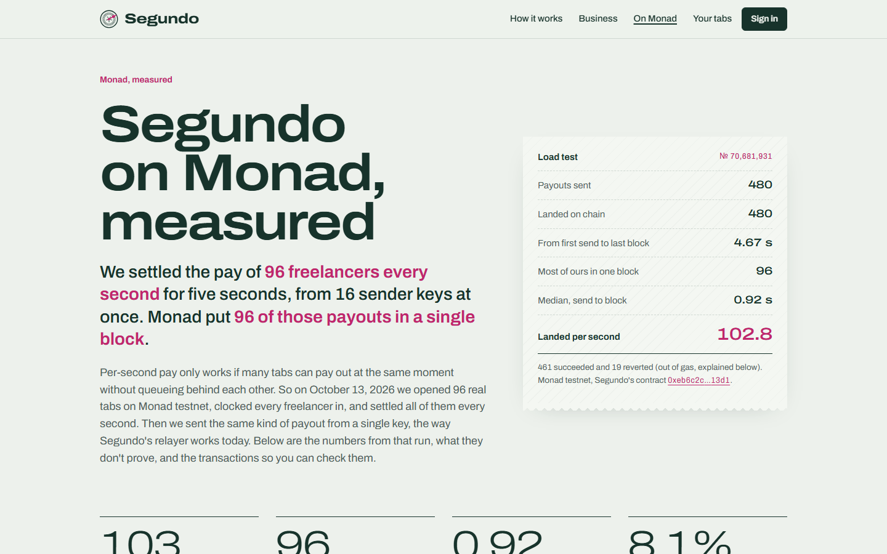<br/><sub><b>Monad, measured.</b> 480 payouts from 16 keys in 4.67 s, 96 in one block, every transaction linked.</sub></td>
  </tr>
  <tr>
    <td>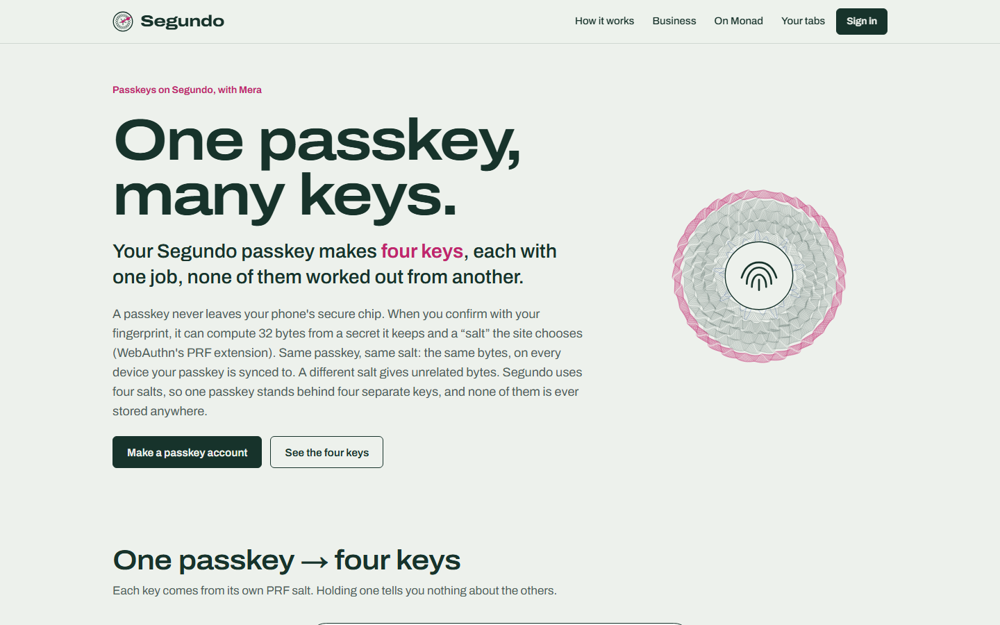<br/><sub><b>One passkey, four keys.</b> Wallet, sealing, invite and disclosure keys, each from its own PRF salt.</sub></td>
    <td>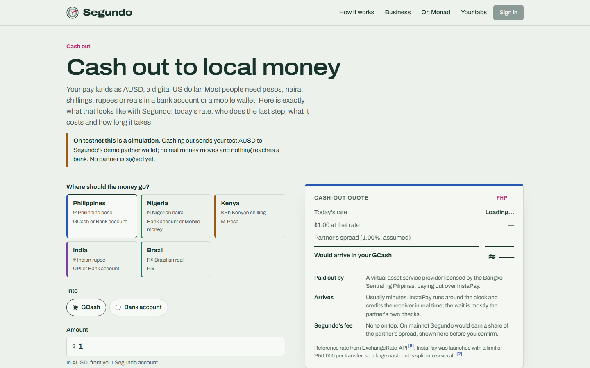<br/><sub><b>Cash out.</b> Today's rate, the partner's assumed spread and the local rail, per corridor. Simulated on testnet.</sub></td>
  </tr>
  <tr>
    <td>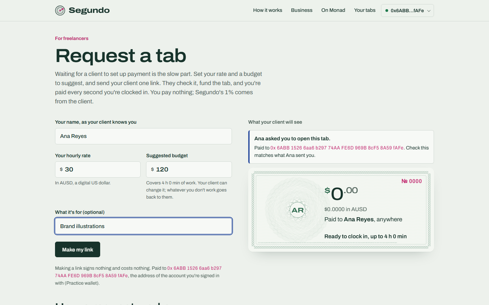<br/><sub><b>Request a tab.</b> A freelancer sets rate and budget and sends one link; nothing is signed to make it.</sub></td>
    <td>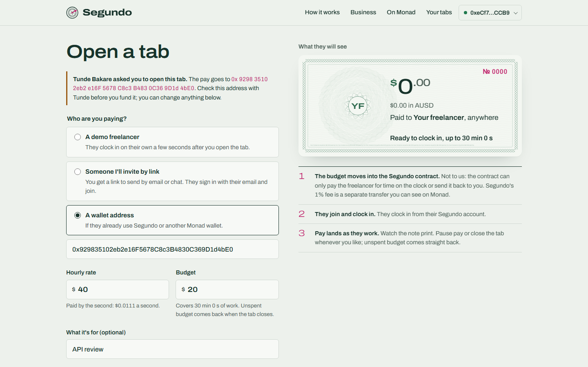<br/><sub><b>The client's side.</b> The link fills the form and shows the address in groups of four to check before funding.</sub></td>
  </tr>
  <tr>
    <td>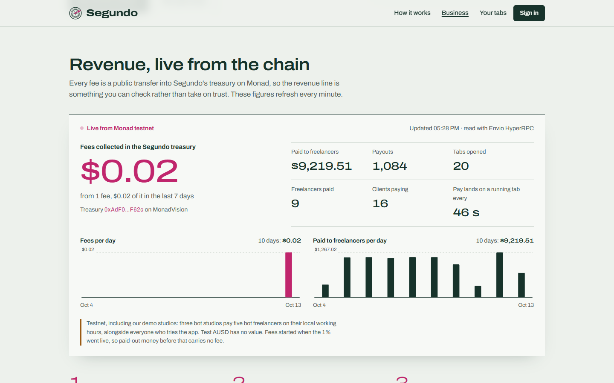<br/><sub><b>Revenue, live from the chain.</b> Fees matched to funding, net of refunds, split into our demo studios and everyone else.</sub></td>
    <td>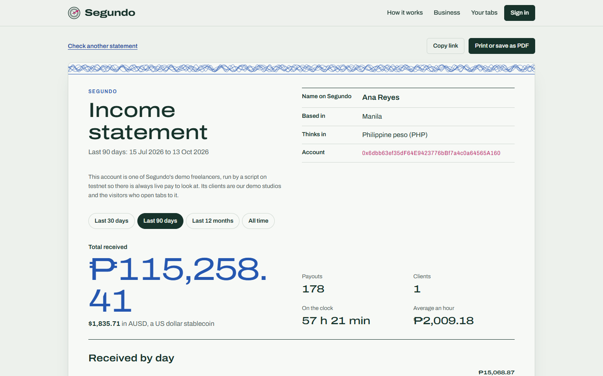<br/><sub><b>Income statement.</b> Every payout a freelancer received, in their currency, each line a Monad transaction.</sub></td>
  </tr>
</table>

<p align="center">
  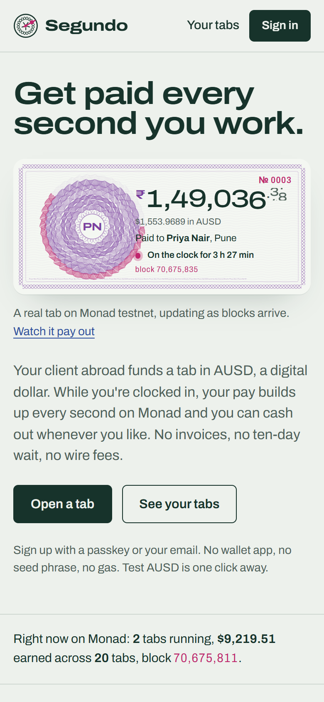
  &nbsp;
  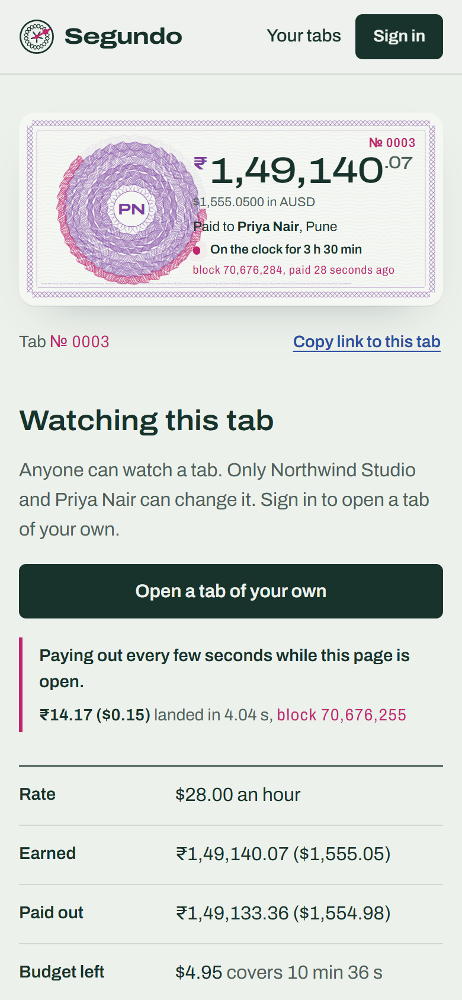
  <br/><sub>Built phone-first: home and a live tab at 390 px. On Android it installs as an app; elsewhere, add it to the home screen.</sub>
</p>

## Business model

**Clients pay a 1% fee on top of every budget and top-up. Freelancers pay nothing.** A $1,000 budget costs the client $1,010 and the whole $1,000 stays available to the freelancer. When the tab closes, the unspent budget goes back to the client and so does 1% of it, so the client pays 1% of what was actually worked. The fee also pays for everyone's gas.

It is **live on testnet** ([`web/app/api/relay/route.ts`](web/app/api/relay/route.ts), [`web/lib/refund.ts`](web/lib/refund.ts)):

- **Fee first.** The client signs an AUSD transfer authorisation (EIP-3009) of the fee to the treasury in the same step as the open or top-up. The relayer checks it, simulates it, sends it, and only then sends the open. Collected first, the fee can't be dodged by moving the money away in between.
- **Failed open, whole fee back.** If the open or top-up then fails, the treasury sends the whole fee back at once.
- **1% of the unspent budget back at close.** The treasury signs an EIP-3009 transfer, the relayer submits it (the treasury never needs MON), and its nonce is derived from the tab id, so AUSD itself refuses a second refund for the same tab.

The full cycle is on chain in [VERIFY.md](VERIFY.md#the-1-fee-on-chain): fee → open → close → refund of 17,200 units (1% of the 1,720,000 returned), and a forced failure whose fee came straight back. The demo studios pay the fee too.

| Revenue line | Status |
|---|---|
| 1% client fee on every budget and top-up, net of the close-time refund | **Live on testnet** |
| A share of the reserve yield on budgets waiting in tabs (Agora shares AUSD treasury yield with partners: [LayerZero x Agora](https://layerzero.network/blog/agora-and-layerzero-bring-ausd-to-5-blockchains)) | Next, with mainnet |
| A share of the spread on cash-outs through licensed local payout partners ([/cashout](https://segundo.world/cashout)) | Simulated on testnet; no partner signed |
| Advances against verified on-chain income (the income statement is the underwriting record) | Later |

The [business page](https://segundo.world/business) shows the treasury live: fees counted only when matched to an open or top-up, net of refunds, with any unmatched opens listed; tabs and pay split into **our demo studios** and **everyone else**; gas per action averaged from the relayer's own receipts (a payout 97,673 gas, a forwarded open 512,162, a fee or refund transfer 113,517); and a calculator that gives the MON price at which gas would eat the whole fee.

## Bounties

### Agora: a cross-border payments app with Mera onboarding and instant settlement

| | |
|---|---|
| **Mobile app** | Android: a Trusted Web Activity, [`android/`](android) (package `world.segundo.app`, about 0.6 MB, full screen through [`web/public/.well-known/assetlinks.json`](web/public/.well-known/assetlinks.json)), served at [segundo.world/segundo.apk](https://segundo.world/segundo.apk). Every phone: an installable web app ([`app/manifest.ts`](web/app/manifest.ts), [`public/sw.js`](web/public/sw.js), [`components/InstallApp.tsx`](web/components/InstallApp.tsx)) with a bottom bar on phones. |
| **Mera onboarding** | A passkey makes the account and its wallet in one tap ([`web/lib/mera.ts`](web/lib/mera.ts)); 25 test AUSD arrive on sign-up. [mera.segundo.world](https://mera.segundo.world) is the same app with Mera as the only way in. |
| **Send across borders** | From the wallet's **Send** sheet ([`components/SendSheet.tsx`](web/components/SendSheet.tsx)): **by link**, the receiver needs nothing but the link ([`lib/sendlink.ts`](web/lib/sendlink.ts), [`app/claim`](web/app/claim/page.tsx)); **to an email**, a wallet Privy makes for that address ([`app/api/recipient`](web/app/api/recipient/route.ts)); or **to a wallet address**. Every send is an AUSD EIP-3009 transfer the relayer submits ([`app/api/send`](web/app/api/send/route.ts)), so nobody needs MON. |
| **Get paid** | Tabs pay by the second in AUSD (EIP-2612 permits to fund, EIP-3009 for fees, refunds and sends). A freelancer can [request a tab](https://segundo.world/request) with a link that fills in the client's form ([`lib/request.ts`](web/lib/request.ts)). |
| **Cash out** | [/cashout](https://segundo.world/cashout) ([`app/cashout`](web/app/cashout/page.tsx), [`corridors.ts`](web/app/cashout/corridors.ts)): Philippines (InstaPay), Nigeria (NIP), Kenya (M-Pesa), India (UPI/IMPS), Brazil (Pix), with today's rate, the partner's assumed spread and sources. On testnet it sends test AUSD to a demo partner wallet, [`0x0921…77e6`](https://testnet.monadvision.com/address/0x092178787c772cbF67c2560B38D9F4f3454677e6); a $1.00 cash-out: [`0xb983cf55…`](https://testnet.monadvision.com/tx/0xb983cf55afa085dec092a40238b6ac197934e476d7ea03f6644602ca0aafa351). |
| **Instant settlement** | A payout lands about a second after it is sent; Monad's blocks average 0.305 s (measured over 10,000 blocks). See [Monad integration](#monad-integration). |

**Send by link, in detail.** The sender's browser makes a fresh key, moves the AUSD to its address and puts the key after the `#` of a link (`/claim#k=…&a=…&c=…&f=…`), which browsers never send to a server. The receiver opens it, sees the amount in their own currency, makes an account with a passkey, and the link's key signs one transfer of its whole balance to them; someone who arrives signed out gets it with one passkey tap. Until then the sender can share it again or **take it back** from "Sent by link", which is the same transfer signed back to them. The page reads the link's balance from Monad, never from the link.

### Privy: beyond authentication

[segundo.world/privy](https://segundo.world/privy) · [`web/lib/wallet.tsx`](web/lib/wallet.tsx) · [`web/lib/privy-server.ts`](web/lib/privy-server.ts) · [`web/app/api/recipient/route.ts`](web/app/api/recipient/route.ts)

- **The embedded wallet signs every EIP-712 request** the app makes: ERC-2771 forward requests for each tab action, AUSD permits, the fee authorisation and transfer authorisations for sends and cash-outs. Privy's wallet UI is hidden, so each action is one tap with no gas and no pop-up.
- **Pregenerated wallets for people who aren't here yet.** Sending to an email calls Privy's REST API from the server with the app secret: `POST /v1/users/email/address` to find the person, `POST /v1/users` with a pregenerated Ethereum wallet to create them, `POST /v1/users/{id}/wallets` if an existing user has none. The AUSD lands in that wallet on Monad; when they first choose "Continue with email", Privy opens the same account and the money is there. The route answers the same way for new and existing people and is rate limited per caller, so it can't be used to sweep a list of addresses.
- **Key export.** Privy's own export window, from the account menu (`useExportWallet`); Segundo never sees the key.
- **Custody, said plainly.** The account menu says who holds the key ("created and secured by Privy").

### Mera: one passkey, many keys

[segundo.world/keys](https://segundo.world/keys) · [`web/lib/keys.ts`](web/lib/keys.ts) · [`web/lib/mera.ts`](web/lib/mera.ts) · [`web/lib/seal.ts`](web/lib/seal.ts) · [`web/lib/disclose.ts`](web/lib/disclose.ts)

One passkey stands behind four keys. Each comes from its own WebAuthn PRF salt, so none can be worked out from another, and none is ever stored.

| Key | PRF salt | Becomes | Used for |
|---|---|---|---|
| Wallet | `sha256("mera.prf.salt.v1")` | BIP-39 → `m/44'/60'/0'/0/0`, in a Mera signing session | Signing pay (Mera's own derivation) |
| Seal | `sha256("segundo/seal/v1")` | HKDF → AES-256-GCM | Sealing legal name, address, tax ID and payout account in the browser ([`SealedDetails.tsx`](web/components/SealedDetails.tsx)) |
| Invite | `sha256("segundo/invite/v1")` | HKDF per tab → secp256k1 | Invite links that can be **rebuilt from chain state** |
| Disclose | `sha256("segundo/disclose/v1")` | HKDF → X25519 | **Selective disclosure** of sealed details to one verifier |

- **Invite keys rebuilt from the chain.** A tab opened "by invite" stores the address of a one-time key; the link carries its private half. Here that key is `HKDF(PRF, info = "tab:" + chain + ":" + till + ":" + payer + ":" + slot)`, where `slot` is the tab's position in `Till.tabsOf(payer)`. Lose the browser, sign in with the same passkey on any device, and the tab page rebuilds the exact link; the contract's stored invite address confirms it ([`components/RebuildInvite.tsx`](web/components/RebuildInvite.tsx)).
- **Selective disclosure.** A landlord or bank opens `/proof/<address>?request=1`; their browser makes a one-time X25519 key and shows a request code. The freelancer ticks the fields to share and confirms once: one fingerprint prompt evaluates two salts (seal and disclose). The page signs a one-line certificate with the wallet key binding the disclosure key to the account, encrypts the fields to the verifier (X25519 → HKDF → AES-256-GCM, bound to the chain, the statement URL, the block and both keys) and returns a reply link. The verifier's page checks the certificate recovers to the statement's account, decrypts, and shows the details beside the on-chain totals. No server sees anything ([`components/Disclosure.tsx`](web/components/Disclosure.tsx)).
- **Pinned relying party.** Passkeys are made for `segundo.world` on every Segundo host, including mera.segundo.world, so one passkey opens one account everywhere and a look-alike host can't ask for its PRF output.

### Mera: passkey onboarding people don't notice

- **One tap to an account.** "Create your account with a passkey" leads on every sign-in panel; "Sign back in" leads once a passkey was used in this browser. No seed phrase, no gas, and 25 test AUSD arrive.
- **Signing that stays out of the way.** The key lives in a Mera signing session that ends after 15 minutes without a tap or 5 minutes in the background ([`web/lib/wallet.tsx`](web/lib/wallet.tsx)); the next signature asks for the passkey again. A budget, its permit and its fee are one prompt.
- **Claim with a fingerprint.** Opening a send link signed out, then making a passkey account, collects the money straight away ([`app/claim/page.tsx`](web/app/claim/page.tsx)).
- **A passkey-only site.** [mera.segundo.world](https://mera.segundo.world) never loads Privy and offers no practice wallet (`isMeraHost` in `wallet.tsx`, or `NEXT_PUBLIC_ACCOUNTS=mera`).
- **Plain errors.** Mera's error codes become one sentence each (`meraMessage` in `mera.ts`); authenticators without PRF are pointed to email sign-in; preview hosts say accounts made there open only there.

### Envio: HyperRPC drives the history, statements and revenue

[`web/lib/envio.ts`](web/lib/envio.ts) · [`web/app/api/stats`](web/app/api/stats/route.ts) · [`web/app/api/history`](web/app/api/history/route.ts) · [`web/app/proof/[address]`](web/app/proof/%5Baddress%5D/page.tsx)

Monad's public RPC caps `eth_getLogs` at 100 blocks. HyperRPC answers a log query over up to 3,000,000 blocks, so `envio.ts` reads every Till event since deployment, every AUSD transfer into the treasury (fees) and out of it (refunds) in a few calls, keeps them in memory and reads only new blocks after that. That ledger powers:

- **`/api/stats`** and the [business page](https://segundo.world/business): fees matched to the open or top-up they paid for (`feeTabs`), refunds, net revenue, the demo/outside split, opens that skipped the fee, a row per day.
- **`/api/history`** and every pay stub: one address's tabs, payouts, refunds, top-ups and fees.
- **Income statements** at `/proof/<address>`, the record the disclosure flow above binds to.
- **Fee refunds at close** (`web/lib/refund.ts`) fall back to the ledger for long tabs whose history is too long to walk block by block.

If HyperRPC is unreachable the routes fall back to a short public-RPC window and say `source: "rpc"`. [`indexer/`](indexer) holds an Envio HyperIndex project over HyperSync for the same ledger (tabs, payouts, shifts, fees, fee refunds and the CRE workflow's rates; 5 tests); the live site reads HyperRPC.

### Chainlink CRE: a decentralised keeper and an FX oracle

[`cre/`](cre) · [`cre/segundo-keeper/workflow.ts`](cre/segundo-keeper/workflow.ts) · [`cre/contracts/src/SegundoKeeper.sol`](cre/contracts/src/SegundoKeeper.sol) · [SIMULATION.md](cre/SIMULATION.md)

A cron workflow reads Till's running tabs on Monad, picks the ones owing at least $0.01, fetches USD rates for PHP, NGN, INR, BRL, KES and EUR from three public sources (median per node, then median across the DON), and writes one report. **SegundoKeeper** ([`0xFEf8…d80D`](https://testnet.monadvision.com/address/0xFEf8d6A7aF00ACd33FDdd2Ef8800cab78164d80D), Sourcify exact match) accepts reports only from the CRE forwarders, calls `Till.settleMany` (falling back to one tab at a time so a bad tab can't block the rest) and stores the rates with their DON time.

`cre workflow simulate --broadcast` on Monad testnet: [`0x17d86a59…`](https://testnet.monadvision.com/tx/0x17d86a590a0ed22bc60d941db6d0b0e462a449a6f7fe48a43704d97ebe975d03), block 70,688,328: six rates posted and three tabs settled, **4.238888 AUSD** to three freelancers.

## Monad integration

| Measured on Monad testnet, Oct 13 2026 | |
|---|---|
| Average block time over 10,000 blocks | **0.305 s** |
| 480 payouts from 16 sender keys | **4.67 s, 102.8 a second**, all 480 landed (461 succeeded; 19 ran out of a deliberately tight gas limit) |
| Most payouts in one block | **96**; the busiest block used 8.1% of its gas limit |
| Send to block, median / 90th percentile | **0.92 s / 1.56 s** |
| One key, 48 consecutive nonces sent at once | **all 48 in one block**, 0.91 s |
| One key, one at a time (the old relayer loop) | 1.1 a second |

Method, scripts and every transaction: [/network](https://segundo.world/network), [`scripts/bench`](scripts/bench/README.md), [`web/public/bench.json`](web/public/bench.json). Benchmark tabs are left out of every other figure on the site.

- **The relayer follows the measurement.** One key is not Monad's limit, so [`sendAndWait`](web/lib/server.ts) only serialises picking the nonce and handing the transaction to the node; the wait for the block runs alongside others, and one receipt watcher per server instance reads each new block's receipts once (`eth_getBlockReceipts`). [`web/lib/pool.ts`](web/lib/pool.ts) adds a pool of relayer keys (`KEEPER_KEY` plus `RELAYER_KEYS`): payouts go to a key chosen by tab id and sends by the sender's address, so one person's actions keep their order while others run alongside, and the richest key takes over when one runs low.
- **Pay you can watch arrive.** The tab page settles every few seconds while open and shows how long each payout took; the last seconds of pay are sent the moment a clock stops.
- **Built for parallel execution.** Pay accrues from timestamps, so nothing is written while the clock runs, and each tab's state is its own. The shared slots are few and known: `tabCount` on open, and the escrow balance inside AUSD on every payout, which Monad's optimistic execution re-runs when two land in one block. `settleMany` pays many tabs in one transaction.
- **Gas limit, not gas used.** Monad charges the limit, so every transaction uses Monad's own estimate plus a small margin, and the relayer refuses forwarded requests asking for more than 1.5× its own estimate. Gas per action, from the relayer's receipts, is on the [business page](https://segundo.world/business).
- **The 100-block log cap.** Each tab links its changes block to block (`Activity(id, prevBlock)`), so a pay stub is read with one exact-block query per step; the long view comes from Envio HyperRPC.
- **Live from the chain.** The site follows Monad's `newHeads` subscription; the landing page's numbers, world clocks and receipt come from contract state and exact-block log reads.

## Architecture

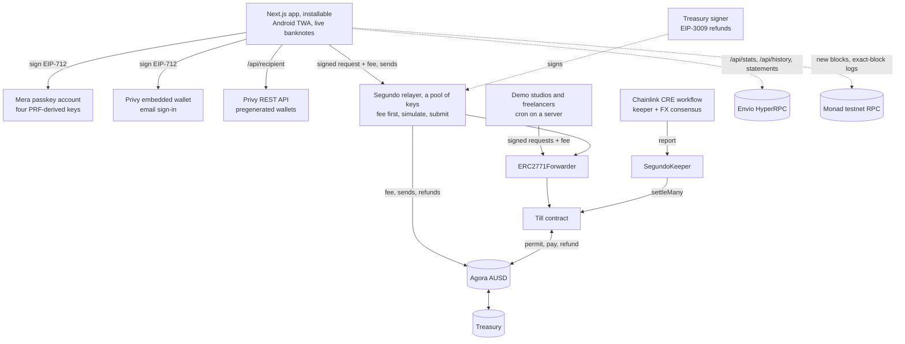

```
contracts/   Till.sol (Solidity 0.8.28, OpenZeppelin 5.4), 53 Foundry tests, deploy script
web/         Next.js 15 app and API routes: relay (fee first, refunds), send, recipient, settle, faucet, live, stats,
             history, health, exchange rates; Mera and Privy wallets, four passkey keys, send links, service worker
android/     Trusted Web Activity for segundo.world (world.segundo.app)
cre/         Chainlink CRE workflow (TypeScript) and the SegundoKeeper receiver (Foundry)
indexer/     Envio HyperIndex project for the same ledger
bots/        Seeded studios (Berlin, Austin, Singapore) and freelancers (Manila, Lagos, Pune, São Paulo, Nairobi)
             on their local working hours, the keeper, and the proof run
scripts/     ABI export, end-to-end UI tests, the Monad load benchmark, screenshots
```

## Contracts

The contract is deployed under Segundo's working name, **Till**; the forwarder's EIP-712 domain name is also `"Till"`.

| | Address | |
|---|---|---|
| **Till** | [`0xeb6c2c519c9bcc4495364c34ac116c20098113d1`](https://testnet.monadvision.com/address/0xeb6c2c519c9bcc4495364c34ac116c20098113d1) | Sourcify exact match |
| Gasless forwarder (OpenZeppelin `ERC2771Forwarder`) | [`0xB0Af71Dfb11df900B2B1a63De0D156e7f035B4D1`](https://testnet.monadvision.com/address/0xB0Af71Dfb11df900B2B1a63De0D156e7f035B4D1) | Sourcify exact match |
| **SegundoKeeper** (Chainlink CRE receiver) | [`0xFEf8d6A7aF00ACd33FDdd2Ef8800cab78164d80D`](https://testnet.monadvision.com/address/0xFEf8d6A7aF00ACd33FDdd2Ef8800cab78164d80D) | Sourcify exact match |
| AUSD (Agora) | [`0xa9012a055bd4e0eDfF8Ce09f960291C09D5322dC`](https://testnet.monadvision.com/address/0xa9012a055bd4e0eDfF8Ce09f960291C09D5322dC) | [Agora's deployments](https://docs.agora.finance/developer/contract-deployments) |
| Segundo treasury | [`0xAdF0F9443EafD19916cBd8f7541ea5e19e69F62c`](https://testnet.monadvision.com/address/0xAdF0F9443EafD19916cBd8f7541ea5e19e69F62c) | A plain account: receives fees, signs refunds |
| Demo payout partner (cash-out, testnet) | [`0x092178787c772cbF67c2560B38D9F4f3454677e6`](https://testnet.monadvision.com/address/0x092178787c772cbF67c2560B38D9F4f3454677e6) | A plain wallet standing in for a licensed partner |

Till has no owner, no admin key, no upgrade path and no fee switch: earned pay can only go to the freelancer and unspent budget only back to the client. The fee and its refunds never touch the contract; they are separate AUSD transfers.

**Security:** [SECURITY.md](SECURITY.md) covers who can move money, the relayer and its key pool, the fee-first path and refunds, send links, email recipients, passkey keys and disclosure, the pinned relying party, the CRE receiver, and every attack we could think of.

## Tests

| Suite | Count | Run |
|---|---|---|
| Till (Foundry): units, edges, adversary, a 1,000-run fuzz, stateful invariants | 53 | `cd contracts && forge test` |
| Till on a Monad fork with Agora's real AUSD | fork | `forge test --match-contract Fork --fork-url monad_testnet` |
| SegundoKeeper (Foundry) | 9 + 2 fork | `cd cre/contracts && forge test` (fork: `--mt test_fork --fork-url https://testnet-rpc.monad.xyz`) |
| CRE workflow (SDK test runtime, EVM and HTTP mocks) | 6 | `cd cre/segundo-keeper && bun test` |
| HyperIndex handlers | 5 | `cd indexer && pnpm test` |
| End to end, practice wallet: faucet, profile, open, payouts, pause, close, invite on a phone | script | `node scripts/e2e.cjs <baseUrl>` |
| End to end, passkey: Mera account, open with the 1% fee, a payout, close with the fee refund, seal details | script | `node scripts/e2e-mera.cjs <baseUrl>` |
| End to end, send by link: two passkey accounts, collect $1.00 exactly, take a second link back | script | `node scripts/e2e-sendlink.cjs <baseUrl>` |
| End to end, many keys: invite rebuilt after clearing the browser, joined from another browser, details disclosed to a verifier | script | `node scripts/e2e-keys.cjs <baseUrl>` |

The end-to-end scripts drive the real UI with Playwright; the passkey ones use a Chrome virtual authenticator with PRF in place of a fingerprint. Contract claims and the test that proves each are listed in [VERIFY.md](VERIFY.md#tests). CI runs the Foundry suite, the fork rehearsal, and a typecheck and build of the web app on every push.

## Run it locally

```bash
cd contracts && forge test
cd web && npm install && npm run dev
```

`web/.env.local`:

| Variable | |
|---|---|
| `NEXT_PUBLIC_TILL_ADDRESS` | `0xeb6c2c519c9bcc4495364c34ac116c20098113d1` |
| `NEXT_PUBLIC_FORWARDER_ADDRESS` | `0xB0Af71Dfb11df900B2B1a63De0D156e7f035B4D1` |
| `KEEPER_KEY` | Server only. Relayer key 0: pays gas for every signed action, the fee, sends and refunds |
| `RELAYER_KEYS` | Optional, server only. More relayer keys, comma-separated, for the pool |
| `TREASURY_KEY` | Server only. Signs fee refunds (EIP-3009); never sends a transaction itself |
| `FAUCET_KEY` | Server only. Hands out 25 test AUSD and refills from Agora's testnet faucet |
| `NEXT_PUBLIC_PRIVY_APP_ID` | Optional. Without it, email sign-in is hidden; passkeys and practice wallets still work |
| `PRIVY_APP_SECRET` | Optional, server only. Sending to an email address (pregenerated wallets); without it that option says it's off |
| `ENVIO_API_TOKEN` | Optional, server only. HyperRPC for `/api/stats`, `/api/history` and statements; without it they read a short recent window from the public RPC |
| `NEXT_PUBLIC_RP_ID` | Optional. The passkey relying party; defaults to `segundo.world` (localhost uses `localhost`) |
| `NEXT_PUBLIC_ACCOUNTS` | Optional. `mera` builds the passkey-only site; any `mera.*` host does the same |
| `AUTO_REFUEL` | Optional. `1` lets a health check top the relayer up with test MON from the faucet wallet |
| `NEXT_PUBLIC_RPC_URL`, `NEXT_PUBLIC_WS_URL`, `NEXT_PUBLIC_SITE_URL` | Optional overrides; default to Monad's public testnet RPC and segundo.world |

The treasury address is a constant (`TREASURY` in `web/lib/chain.ts`). Passkeys need a secure page: `localhost` or https. `GET /api/health` reports the relayer's and the faucet wallet's test MON against the reserve tiers, and the app shows a notice bar while anything is paused. The Android build is in [`android/README.md`](android/README.md), the CRE workflow in [`cre/README.md`](cre/README.md), the benchmark in [`scripts/bench/README.md`](scripts/bench/README.md).

## Built with

[Monad](https://monad.xyz) testnet · [Agora AUSD](https://www.agora.finance) (EIP-2612, EIP-3009) · [Mera](https://www.npmjs.com/package/@category-labs/mera) passkey accounts (`@category-labs/mera` 0.2) · [Privy](https://privy.io) embedded wallets and REST API · [Envio](https://docs.envio.dev) HyperRPC and HyperIndex · [Chainlink CRE](https://docs.chain.link/cre) (`@chainlink/cre-sdk` 1.23) · [OpenZeppelin 5.4](https://www.openzeppelin.com/contracts) (`ERC2771Forwarder`, `ERC2771Context`, `ReentrancyGuardTransient`, `SafeERC20`) · [Foundry](https://getfoundry.sh) · [Next.js 15](https://nextjs.org) · [viem](https://viem.sh) · [@noble/curves](https://github.com/paulmillr/noble-curves) (X25519) · [@scure/bip32 and @scure/bip39](https://github.com/paulmillr/scure-bip39) · [Android Browser Helper](https://github.com/GoogleChrome/android-browser-helper) · [qrcode](https://www.npmjs.com/package/qrcode) · [Playwright](https://playwright.dev) for the end-to-end tests · Archivo by Omnibus-Type · exchange rates from open.er-api.com.

## Built during Monad Metropolis

Pre-existing code: none. All code in this repository was written during the hackathon (October 2026); no earlier project code is reused.

MIT licence.
