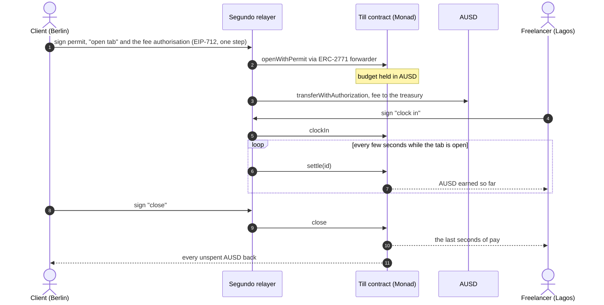
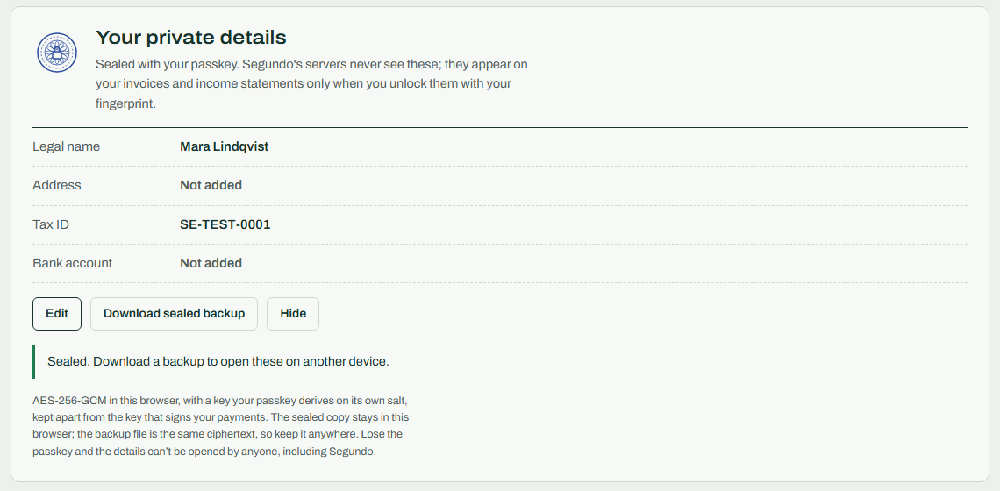
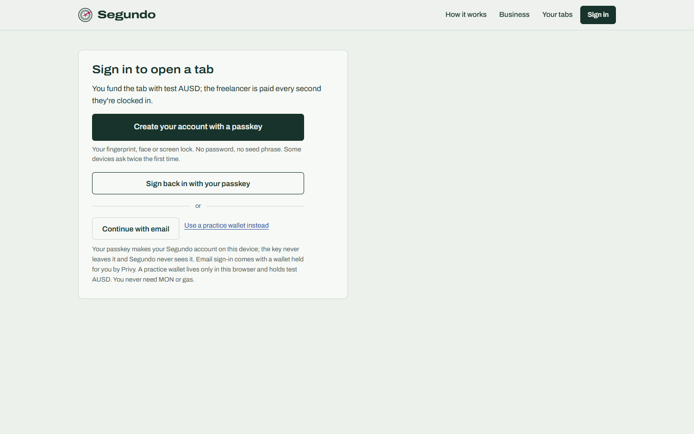
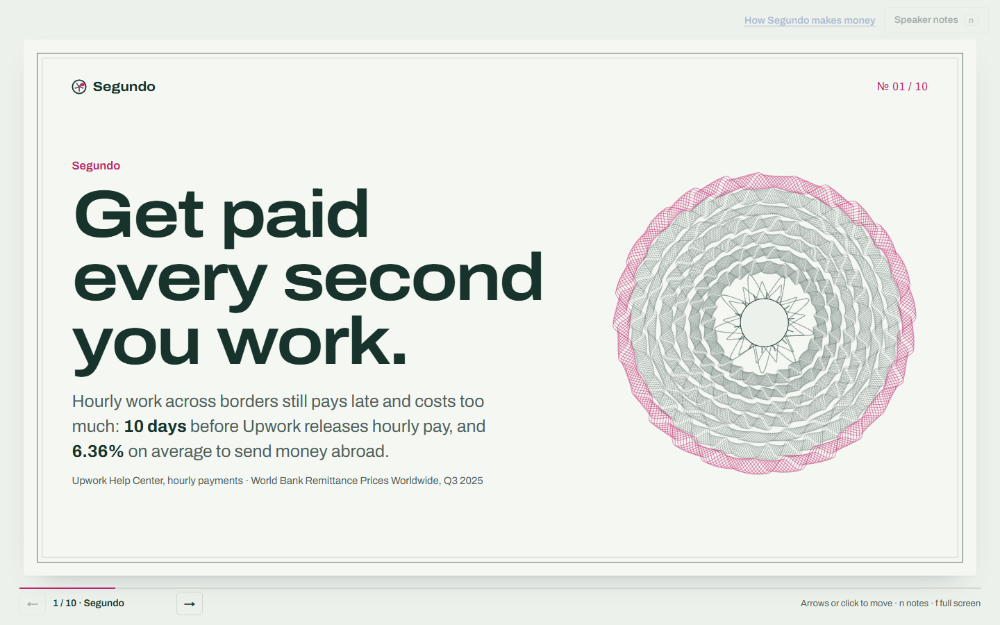
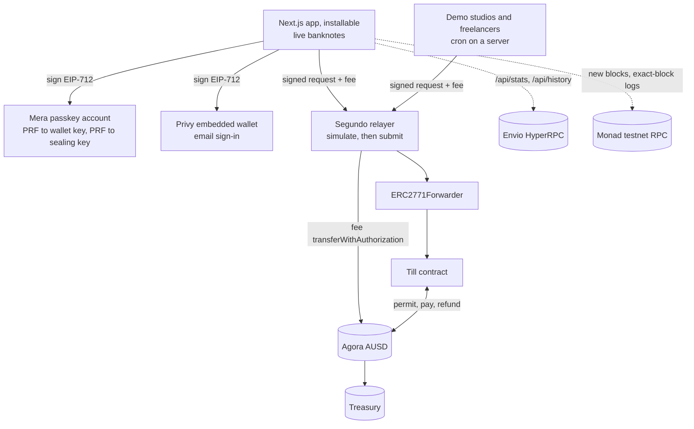

<p align="center">
  
</p>

<p align="center">
  <a href="https://segundo.world"></a>
  
  
  
  <a href="https://github.com/RohanGlitched/segundo/actions/workflows/ci.yml"></a>
  
</p>

<h3 align="center">Cross-border freelancers get paid every second they work.<br/>In Agora's AUSD, on Monad, with a passkey and no gas.</h3>

<p align="center"><i>Segundo means "second" in Spanish, Portuguese and Filipino.</i></p>

| | |
|---|---|
| **App** | [segundo.world](https://segundo.world) (also [till-pay.vercel.app](https://till-pay.vercel.app) while the new domain propagates). Installs on a phone. |
| **Business** | [segundo.world/business](https://segundo.world/business): revenue lines, live treasury, unit economics, market, competition, go-to-market, sources |
| **Deck** | [segundo.world/deck](https://segundo.world/deck) |
| **Income statement** | [A demo freelancer's statement](https://segundo.world/proof/0x6dbb63ef35dF64E9423776bBf7a4c0a64565A160) (Ana Reyes, Manila), rebuilt from Monad through Envio HyperRPC |
| **Contracts** | [Till](https://testnet.monadvision.com/address/0xeb6c2c519c9bcc4495364c34ac116c20098113d1) and [forwarder](https://testnet.monadvision.com/address/0xB0Af71Dfb11df900B2B1a63De0D156e7f035B4D1), both Sourcify exact match; [treasury](https://testnet.monadvision.com/address/0xAdF0F9443EafD19916cBd8f7541ea5e19e69F62c) |
| **Check it** | [VERIFY.md](VERIFY.md) (every action and the 1% fee on chain) · [SECURITY.md](SECURITY.md) |

---

<p align="center">
  
  <br/><sub>A real tab on Monad testnet, recorded from the live site. Lucas in São Paulo is paid by a studio in Singapore; each band of the rosette is a stretch of work, and the amount rolls in his own currency.</sub>
</p>

## The problem

Freelancers outside the US and Europe wait for their money and pay to receive it.

| | |
|---|---|
| **6.36%** | average cost of sending money across borders ([World Bank, Remittance Prices Worldwide, Q3 2025](https://remittanceprices.worldbank.org/sites/default/files/2026-04/RPW_main_report_and_annex_Q325.pdf)) |
| **10 days** | before hourly marketplace pay is released after the work week ([Upwork Help Center](https://support.upwork.com/hc/en-us/articles/211063668-How-payments-for-hourly-contracts-work)) |
| **up to 435M** | online gig workers worldwide, 154M to 435M ([World Bank, 2023](https://openknowledge.worldbank.org/entities/publication/ebc4a7e2-85c6-467b-8713-e2d77e954c6c)) |

And if a client disappears, the freelancer chases an invoice for work already done.

## How it works

A client opens a **tab**: an hourly rate and a budget in **AUSD**, Agora's digital dollar. The budget waits in a contract on Monad that can only pay the freelancer for time on the clock or send it back to the client. While the freelancer is **clocked in**, pay builds up every second; while the tab is open on screen it lands in their wallet every few seconds. Either side can stop the clock at any moment, the client can pause pay or top up, and closing the tab returns every unspent cent in the same block.

Everyone signs in with a **passkey** (or email), nobody needs gas, and the app installs on a phone like any other.



### Try it in one minute

1. Open **[segundo.world](https://segundo.world)** and choose **Open a tab**.
2. **Create your account with a passkey** (or continue with email, or use a practice wallet). No seed phrase, no gas.
3. 25 test AUSD arrive in your new wallet (there's also a **Get 25 test AUSD** button).
4. Pick a demo freelancer, say $40 an hour and a $3 budget. The form shows the 1% fee ($0.03) before you sign. Open the tab; the freelancer clocks in by themselves within seconds. Keep the page open and watch payouts land.
5. Pause pay, top up, or close the tab and see the refund in the pay stub. To be the freelancer, choose **Someone I'll invite by link** and open the link on your phone.

<table>
  <tr>
    <td width="50%"><br/><sub><b>A live tab.</b> Payouts every few seconds while the page is open, each with how long it took to land.</sub></td>
    <td width="50%"><br/><sub><b>Revenue, live from the chain.</b> The treasury's fees and the money around them, read through Envio HyperRPC.</sub></td>
  </tr>
  <tr>
    <td><br/><sub><b>Income statement.</b> Every payout a freelancer received, in their currency, each line a Monad transaction.</sub></td>
    <td><br/><sub><b>Sealed private details.</b> Legal name, tax ID and payout account, encrypted with a key only the passkey can produce.</sub></td>
  </tr>
  <tr>
    <td><br/><sub><b>Passkey first.</b> Mera makes the account from the passkey; email through Privy and a practice wallet are the other ways in.</sub></td>
    <td><br/><sub><b>The deck.</b> Ten slides with speaker notes, at /deck.</sub></td>
  </tr>
</table>

<p align="center">
  
  &nbsp;
  
  <br/><sub>Built phone-first: home and a live tab at 390 px. Add it to the home screen and it opens straight to your tabs.</sub>
</p>

## Business model

**Clients pay a 1% fee on top of every budget and top-up. Freelancers pay nothing.** A $1,000 budget costs the client $1,010, and the whole $1,000 stays available to the freelancer; unspent budget goes back to the client in full. The fee also pays for everyone's gas.

It is **live on testnet**. The fee is an AUSD transfer authorisation (EIP-3009) from the client to the treasury, signed in the same step as the open or top-up and submitted by the relayer once the tab has landed ([`web/app/api/relay/route.ts`](web/app/api/relay/route.ts), `signFee` in [`web/lib/relay.ts`](web/lib/relay.ts), [`web/lib/authorization.ts`](web/lib/authorization.ts)). The demo studios pay it too. Every fee is a public transfer into the **[treasury on MonadVision](https://testnet.monadvision.com/address/0xAdF0F9443EafD19916cBd8f7541ea5e19e69F62c)**, and [VERIFY.md](VERIFY.md#the-1-fee-on-chain) shows how to find them.

| Revenue line | Status |
|---|---|
| 1% client fee on every budget and top-up | **Live on testnet** |
| A share of the reserve yield on budgets waiting in tabs (Agora shares AUSD treasury yield with partners: [LayerZero x Agora](https://layerzero.network/blog/agora-and-layerzero-bring-ausd-to-5-blockchains)) | Next, with mainnet |
| A share of the spread on cash-outs through licensed local payout partners | Next |
| Advances against verified on-chain income (the income statement is the underwriting record) | Later |

The [business page](https://segundo.world/business) has a unit-economics calculator, the competition's published fees with sources, the market, go-to-market and milestones.

## What's new for the bounties

**Agora: cross-border payments app with Mera passkey onboarding.** A freelancer in Lagos gets an account from a fingerprint, test AUSD on arrival, and pay that lands on Monad seconds after it is earned, with blocks every 0.3 s. AUSD is used end to end: EIP-2612 permits to fund tabs, EIP-3009 transfer authorisations for fees and for **Send AUSD to someone** (the receiver sees it a second later in their own currency). The site is an installable phone app: [`app/manifest.ts`](web/app/manifest.ts), a service worker ([`public/sw.js`](web/public/sw.js)), and [`components/InstallApp.tsx`](web/components/InstallApp.tsx) (a QR code to hand off from a computer, Add to Home Screen steps on iOS, the install prompt on Android), with a bottom bar when it runs from the home screen.

**Privy beyond login.** Email sign-in creates a Privy embedded wallet for every user on Monad, and that wallet signs **every EIP-712 request the app makes**: ERC-2771 forward requests for each tab action, AUSD permits, the fee authorisation and transfer authorisations for sends. Privy's wallet UI is hidden, so each action is one tap with no gas and no pop-up ([`web/lib/wallet.tsx`](web/lib/wallet.tsx)).

**Mera: one passkey, many keys.** The passkey account is the main way in ([`web/lib/mera.ts`](web/lib/mera.ts)): the WebAuthn PRF output becomes BIP-39 entropy, then the BIP-44 key at `m/44'/60'/0'/0/0`, held in a Mera signing session that locks after 15 minutes idle or 5 minutes in the background. The creative part is a **second PRF evaluation with its own salt**, `sha256("segundo/seal/v1")`, HKDF'd into an AES-256-GCM key that seals a freelancer's legal name, address, tax ID and payout account in the browser ([`web/lib/seal.ts`](web/lib/seal.ts), [`components/SealedDetails.tsx`](web/components/SealedDetails.tsx)). The servers never see them; a sealed backup file moves them to another device; and the owner can unseal them onto their own printed income statement for a landlord, bank or visa office. The sealing key shares nothing with the wallet key.

**Envio HyperRPC.** Monad's public RPC caps `eth_getLogs` at 100 blocks. HyperRPC answers 400,000-block ranges, so [`web/lib/envio.ts`](web/lib/envio.ts) reads every Till event since deployment and every fee into the treasury in a few calls, keeps them in memory and only reads new blocks after that. It powers `/api/stats` (treasury revenue, volume, payouts, a row per day, how often pay lands), `/api/history` (one address's tabs, payouts, refunds, top-ups and fees) and the public income statement at `/proof/<address>`. If HyperRPC is unreachable the routes fall back to a short public-RPC window and say `source: "rpc"`.

## Monad integration

- **Pay you can watch arrive.** Monad makes a block about every 0.3 s with finality in about 0.6 s ([Monad docs](https://docs.monad.xyz/introduction/monad-for-developers); we measured 0.305 s on average over 10,000 testnet blocks on Oct 13). A payout lands while the freelancer is still looking at the screen. The tab page settles every few seconds and shows how long each payout took (0.6 to 2.6 s from a laptop in India in the proof run, [VERIFY.md](VERIFY.md)). Every payout is a transaction the relayer pays for, so the pace eases the longer a page stays open, and the last seconds of pay are sent the moment a clock stops.
- **Built for parallel execution.** Pay accrues from timestamps, so nothing is written while the clock runs, and each tab's state is its own. The shared slots are few and known: `tabCount` on open, and the escrow balance inside AUSD on every payout, which Monad's optimistic execution re-runs when two land in one block. `settleMany` pays many tabs in one transaction.
- **Gas limit, not gas used.** Monad charges the gas limit, so every transaction (relayer, faucet, bots) is sent with Monad's own estimate plus a small margin, never a blanket limit, and the relayer refuses forwarded requests asking for more than 1.5× its own estimate.
- **The 100-block log cap.** Each tab links its changes block to block (`Activity(id, prevBlock)`), so a pay stub is read with one exact-block query per step and no indexer; the long view (statements, revenue) comes from Envio HyperRPC.
- **Live from the chain.** The site follows Monad's `newHeads` subscription; the landing page's numbers, world clocks and receipt come from contract state and exact-block log reads.

## Architecture



```
contracts/   Till.sol (Solidity 0.8.28, OpenZeppelin 5.4), 53 Foundry tests, deploy script
web/         Next.js 15 app and API routes: relay (with the fee), send, settle, faucet, live, stats, history,
             health, exchange rates; Mera and Privy wallets, sealed details, service worker
bots/        Seeded studios (Berlin, Austin, Singapore) and freelancers (Manila, Lagos, Pune,
             São Paulo, Nairobi) on their local working hours, the keeper, and the proof run
scripts/     ABI export, end-to-end UI tests (practice wallet and passkey), screenshots
```

## Contracts and verification

The contract is deployed under Segundo's working name, **Till**; the forwarder's EIP-712 domain name is also `"Till"`.

| | Address | |
|---|---|---|
| **Till** | [`0xeb6c2c519c9bcc4495364c34ac116c20098113d1`](https://testnet.monadvision.com/address/0xeb6c2c519c9bcc4495364c34ac116c20098113d1) | Sourcify exact match |
| Gasless forwarder (OpenZeppelin `ERC2771Forwarder`) | [`0xB0Af71Dfb11df900B2B1a63De0D156e7f035B4D1`](https://testnet.monadvision.com/address/0xB0Af71Dfb11df900B2B1a63De0D156e7f035B4D1) | Sourcify exact match |
| AUSD (Agora) | [`0xa9012a055bd4e0eDfF8Ce09f960291C09D5322dC`](https://testnet.monadvision.com/address/0xa9012a055bd4e0eDfF8Ce09f960291C09D5322dC) | [Agora's deployments](https://docs.agora.finance/developer/contract-deployments) |
| Segundo treasury (receives the 1% fee) | [`0xAdF0F9443EafD19916cBd8f7541ea5e19e69F62c`](https://testnet.monadvision.com/address/0xAdF0F9443EafD19916cBd8f7541ea5e19e69F62c) | A plain account |

The contract has no owner, no admin key, no upgrade path and no fee switch: earned pay can only go to the freelancer and unspent budget only back to the client. The fee never touches the contract; it is a separate AUSD transfer the client signs.

[VERIFY.md](VERIFY.md) lists one tab through every action with fresh wallets (17 transactions) and the fee transfers into the treasury with their matching opens. [SECURITY.md](SECURITY.md) covers who can move money, the relayer and fee path, passkey sessions, sealed details and every attack we could think of.

## Tests

| Claim | Proof |
|---|---|
| Pay accrues per second, only while clocked in | `test_paysBySecondAndRefundsTheRest`, `test_noPayWhileClockedOut` |
| The client can pause pay at any moment | `test_clientHoldStopsTheClock` |
| Pay never exceeds the budget | `test_budgetCapsPayAndTopUpRestartsTheShift` |
| Invite links can't be stolen from the mempool | `test_inviteClaimCannotBeStolen` |
| Paid + refunded always equals the budget | `testFuzz_moneyIsConserved` (1,000 runs) |
| Whatever happens in any order, escrow equals what open tabs still hold and pay never goes down | `TillInvariantTest`: 2 stateful invariants over 12,800 random actions |
| Edge cases hold: top-ups mid-shift and at exhaustion, duplicate settles, extreme rates, issuer freezes, dust tabs | `TillEdges.t.sol`, 32 tests |
| A hostile token or receiver cannot re-enter `settle`, `settleMany` or `close`; an invite signature is bound to its tab, contract and chain; the rate can never change under a running shift | `TillAdversary.t.sol`, 7 tests |
| Fully gasless with an AUSD permit and the forwarder | `test_gaslessOpenWithPermitAndClockIn`, plus a fork test with Agora's real AUSD |
| Every action works on Monad testnet | [VERIFY.md](VERIFY.md): 17 transactions, one per action, with fresh wallets |
| The whole UI works with a practice wallet | `scripts/e2e.cjs`: faucet, profile, open, payouts, pause, close, invite on a phone |
| The whole UI works with a passkey | `scripts/e2e-mera.cjs`: a Chrome virtual authenticator with PRF creates a Mera account, gets test AUSD, opens a tab with the 1% fee, sees a payout land, seals private details |

```bash
cd contracts
forge test                                                   # 53 tests: units, edges, adversary, a 1,000-run fuzz, stateful invariants
forge test --match-contract Fork --fork-url monad_testnet    # Agora AUSD on a Monad fork

node scripts/e2e.cjs http://localhost:3000                   # needs Playwright
node scripts/e2e-mera.cjs http://localhost:3000
```

CI runs the Foundry suite, the fork rehearsal and a typecheck of the web app on every push.

## Run it locally

```bash
cd contracts && forge test
cd web && npm install && npm run dev
```

`web/.env.local`:

| Variable | |
|---|---|
| `NEXT_PUBLIC_TILL_ADDRESS` | `0xeb6c2c519c9bcc4495364c34ac116c20098113d1` |
| `NEXT_PUBLIC_FORWARDER_ADDRESS` | `0xB0Af71Dfb11df900B2B1a63De0D156e7f035B4D1` |
| `NEXT_PUBLIC_PRIVY_APP_ID` | Optional. Without it, email sign-in is hidden; passkeys and practice wallets still work |
| `KEEPER_KEY` | Server only. The relayer's key; it pays gas for every signed action and submits the fee |
| `FAUCET_KEY` | Server only. Hands out 25 test AUSD and refills from Agora's testnet faucet |
| `ENVIO_API_TOKEN` | Server only. Envio HyperRPC for `/api/stats`, `/api/history` and income statements; without it they read a short recent window from the public RPC |
| `AUTO_REFUEL` | Optional. `1` lets a health check top the relayer up with test MON from the faucet wallet |
| `NEXT_PUBLIC_RPC_URL`, `NEXT_PUBLIC_WS_URL`, `NEXT_PUBLIC_SITE_URL` | Optional overrides; default to Monad's public testnet RPC and segundo.world |

The treasury address is a constant (`TREASURY` in `web/lib/chain.ts`). Passkeys need a secure page: `localhost` or https. A passkey is bound to the site it was made on, so an account made on one domain opens on that domain.

Operating it: `GET /api/health` reports the relayer's and the faucet wallet's test MON against the reserve tiers (watch-payouts pause first, then new tabs and sends, then clock-ins; closes and clock-outs run down to about one transaction's worth) and the app shows a notice bar while anything is paused. `node bots/topup.mjs keeper=10` moves test MON between the project's wallets; the bots log loudly when the keeper runs low. The service worker registers in production builds only.

## Built with

[Monad](https://monad.xyz) testnet · [Agora AUSD](https://www.agora.finance) (EIP-2612, EIP-3009) · [Mera](https://www.npmjs.com/package/@category-labs/mera) passkey accounts (`@category-labs/mera` 0.2.0) · [Privy](https://privy.io) embedded wallets · [Envio HyperRPC](https://docs.envio.dev) · [OpenZeppelin 5.4](https://www.openzeppelin.com/contracts) (`ERC2771Forwarder`, `ERC2771Context`, `ReentrancyGuardTransient`, `SafeERC20`) · [Foundry](https://getfoundry.sh) · [Next.js 15](https://nextjs.org) · [viem](https://viem.sh) · [@scure/bip32 and @scure/bip39](https://github.com/paulmillr/scure-bip39) · [qrcode](https://www.npmjs.com/package/qrcode) · [Playwright](https://playwright.dev) for the end-to-end tests · Archivo by Omnibus-Type · exchange rates from open.er-api.com.

## Built during Monad Metropolis

Pre-existing code: none. All code in this repository was written during the hackathon (October 2026); no earlier project code is reused.

MIT licence.
